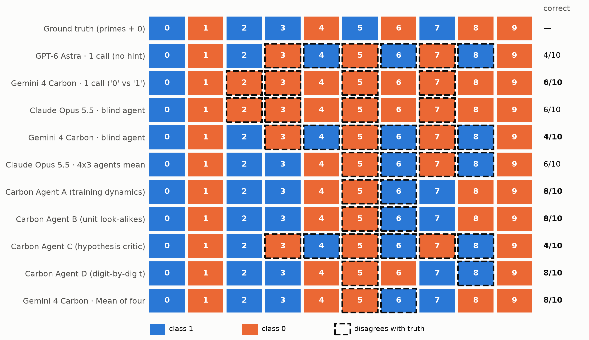
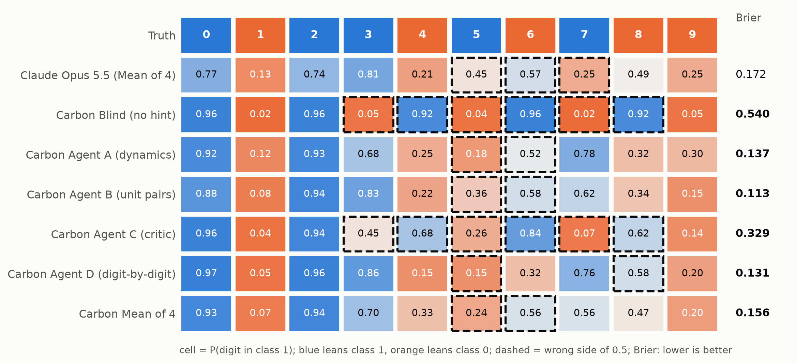

# Evaluating Gemini 4 Carbon (`gemini-4-carbon`)

This folder contains a reproducible, zero-leakage evaluation of **`gemini-4-carbon`** across all three regimes studied in the blog post (single-call raw-weights baseline, blind weights-only agent without hints, and four-agent hinted ensemble).

Strict isolation rules match `astra/` and `agents/`:
- Agentic runs execute inside an isolated `/tmp` workspace containing **only** the permitted weights (`data/weights.txt` or a `prompt-preview.txt` header shim + `agents/experiment.py`).
- Ground truth (`{0, 2, 3, 5, 7}`), `sample50.csv`, `digit_labels.csv`, `README.md`, and `analysis/` are blocked and inaccessible.
- No forward passes on real or synthetic inputs, and no dot products or correlations between weights and imagined digit templates.

---

## Results Summary

Ground truth: **Class 1 (`z > 0`) = `{0, 2, 3, 5, 7}`** (primes plus zero), **Class 0 (`z <= 0`) = `{1, 4, 6, 8, 9}`**.

| Regime | Model | Tools / Agents | Hint | Predicted Class 1 | Digits Correct | Brier Score |
|---|---|---|---|---|---:|---:|
| **1. Single call (`astra/prompt.txt`)** | GPT-6 Astra | 0 tools, 1 call | 1 example (`0` $\to$ 1) | `{0, 2, 4, 6, 8}` (parity) | 4/10 | — |
| **1. Single call (`astra/prompt.txt`, 6 dp)** | **Gemini 4 Carbon** | 0 tools, 1 call | 1 example (`0` $\to$ 1) | `{0}` (`'0'` vs `'1'`) | **6/10** | — |
| **2. Blind weights-only agent** | Claude Opus 5.5 | Python, 2 rounds | None | `{0}` (`0` vs all others) | 6/10 | — |
| **2. Blind weights-only agent** | **Gemini 4 Carbon** | Python + Vision (9 turns) | None | `{0, 2, 4, 6, 8}` (parity) | 4/10 | 0.540 |
| **3. Hinted 5-vs-5 (`four_agent_brief.md`)** | Claude Opus 5.5 | 4 $\times$ 3 = 12 agents | 5-vs-5 MNIST | `{0, 2, 3, 6, 8}` | 6/10 | 0.172 |
| — Carbon Agent A (`training dynamics`) | **Gemini 4 Carbon** | 1 agent (10 turns) | 5-vs-5 MNIST | `{0, 2, 3, 6, 7}` | **8/10** | **0.137** |
| — Carbon Agent B (`unit look-alikes`) | **Gemini 4 Carbon** | 1 agent (10 turns) | 5-vs-5 MNIST | `{0, 2, 3, 6, 7}` | **8/10** | **0.113** |
| — Carbon Agent C (`hypothesis critic`) | **Gemini 4 Carbon** | 1 agent (11 turns) | 5-vs-5 MNIST | `{0, 2, 4, 6, 8}` | 4/10 | 0.329 |
| — Carbon Agent D (`digit-by-digit`) | **Gemini 4 Carbon** | 1 agent (10 turns) | 5-vs-5 MNIST | `{0, 2, 3, 7, 8}` | **8/10** | **0.131** |
| **3. Hinted 5-vs-5 (Mean of four)** | **Gemini 4 Carbon** | **4 single agents** | 5-vs-5 MNIST | **`{0, 2, 3, 6, 7}`** | **8/10** | **0.156** |





---

## Key Observations

1. **Single-call tokenization & reasoning ceiling (`exp1`):**
   - `astra/prompt.txt` (`100,609` 10-decimal floats) is `669,642` tokens under OpenAI's `o200k_base` tokenizer, but `1,280,356` tokens under Gemini's SentencePiece tokenizer (which splits decimal digits individually, exceeding the `1,048,576` input limit). Rounding floats to `6` decimal places (`float32` precision: max logit difference `0.000015` across all 50 MNIST samples, `0` prediction flips) reduces the prompt to **`897,119` Gemini tokens**.
   - At `thinking_level="HIGH"` (and `"MEDIUM"`), `gemini-4-carbon` consumes `32,765` of its `32,768` output token limit on reasoning and hits `MAX_TOKENS`—reproducing the exact failure mode of GPT-6 Astra Request 1 (`responses/exp1_request1_max_tokens.json`).
   - At `thinking_level="LOW"`, it completes in 546 output tokens, recognizes the 28$\times$28 handwritten `'0'` example, locates exact strong neuron weights directly from raw text (`unit 28` $W_2=+1.1748$, `unit 13` $W_2=+0.9288$, `unit 12` $W_2=-0.9144$), and hypothesizes `'0'` (Class 1) vs `'1'` (Class 0) (`0.92` confidence).

2. **Blind weights-only agent (`exp2`, no hint, no example):**
   - Given only `data/weights.txt`, `gemini-4-carbon` independently discovered the exact `67` untouched Kaiming-Uniform pixels ($|W_1| \le 1/28 = 0.035714$, zero weight decay) and the 20-column active span (`cols 4–23`) proving upright, un-augmented MNIST.
   - Unlike blind Claude Opus 5.5 (which guessed single-digit `0` vs rest), blind Carbon deduced from the high-rank singular spectrum of $\operatorname{diag}(W_2)W_1$ that the task was a multi-digit (~5-vs-5) split, then converged on the **parity** attractor `{0, 2, 4, 6, 8}` (`4/10`).

3. **Four-agent hinted ensemble (`exp3`, `four_agent_brief.md`):**
   - Using **4 single agents** (vs. $4 \times 3 = 12$ Claude Opus 5.5 agents), three of the four Carbon specialists achieved **`8/10`** accuracy with strong Brier calibration (`Agent A`: `0.137`, `Agent B`: `0.113`, `Agent D`: `0.131`).
   - **Why Carbon resolved digit `7` (`8/10` vs. Opus ensemble `6/10`):** Agents A, B, and D all noticed that MNIST centers images by **center of mass**, shifting top-heavy `'7'`'s horizontal bar down from `rows 2–5` into `rows 7–11`—dodging the top-edge negative veto of `u68`/`u13` and hitting their excitatory band (`P(7) = 0.56` in the Carbon mean vs. `0.25` in the Opus mean).
   - **Shared blind spot on `{5, 6}`:** Like Claude Opus 5.5 (`P(5)=0.45, P(6)=0.57`), Carbon's ensemble (`P(5)=0.24, P(6)=0.57`) swapped `5` and `6` because `6`'s lower loop overlaps outer-ring Class-1 lobes while `5`'s horizontal neck sits near the upper-left negative slit (`rows 10–13, cols 4–15`) unless evaluated on real stroke distributions via ReLU gating.
   - Notably, `Agent A` (`training dynamics`) also proved purely from weight norms ($\sum \|w_i\|_2^2 = 1300$ vs. $\sum W_{2,i}^2 = 30.2$, violating SGD's Du–Hu–Lee conservation law) that the network was trained with **Adam without weight decay**.

---

## Reproducing

```bash
# With uv (recommended)
export GEMINI_API_KEY="your-key"
uv sync
uv run python carbon/run_carbon_eval.py all      # runs exp1, exp2, exp3 -> carbon/responses/
uv run python carbon/make_carbon_figures.py      # builds carbon/figures/*.png
```

## Files

- `run_carbon_eval.py`: end-to-end evaluation harness (`exp1`, `exp2`, `exp3`) with sandboxed weights-only execution.
- `make_carbon_figures.py`: generates `figures/carbon_scoreboard.png` and `figures/carbon_probs_brier.png`.
- `responses/`: raw JSON transcripts, token usage, and scored probability vectors for every run.
